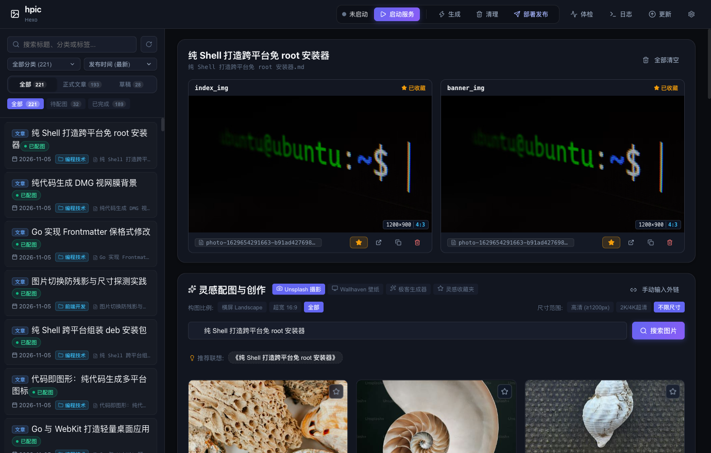
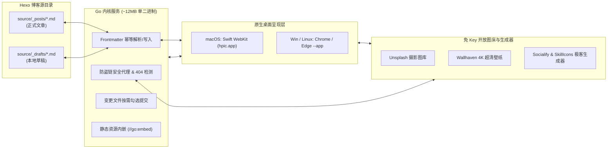
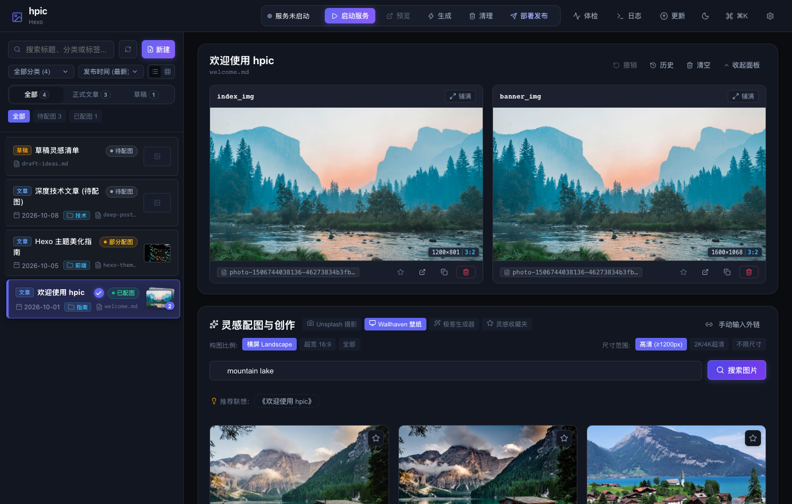
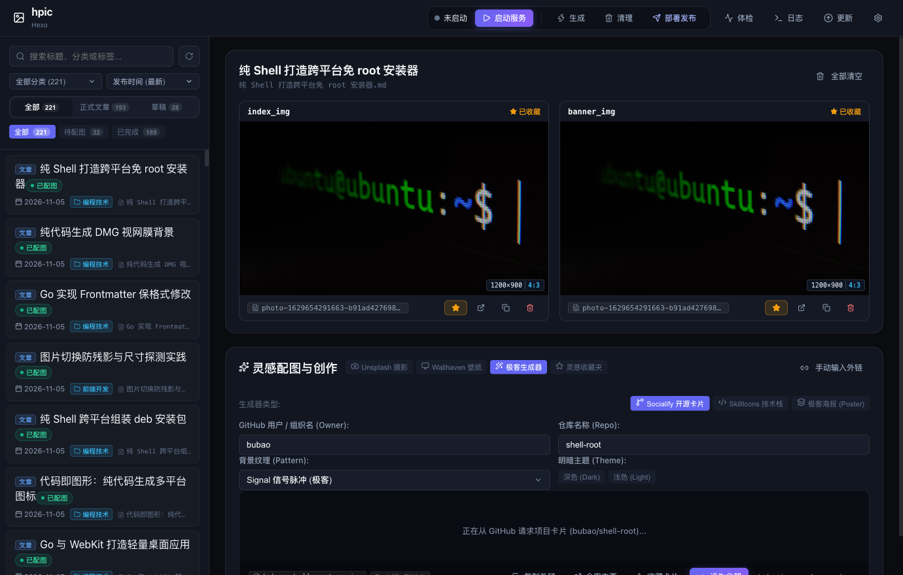
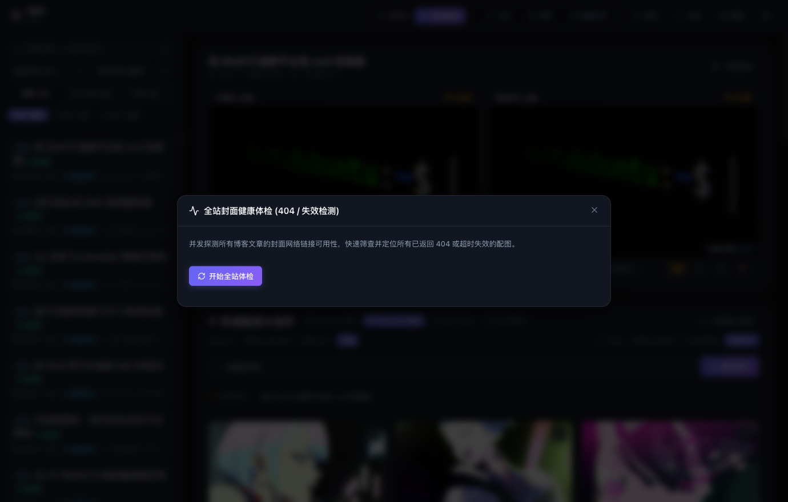
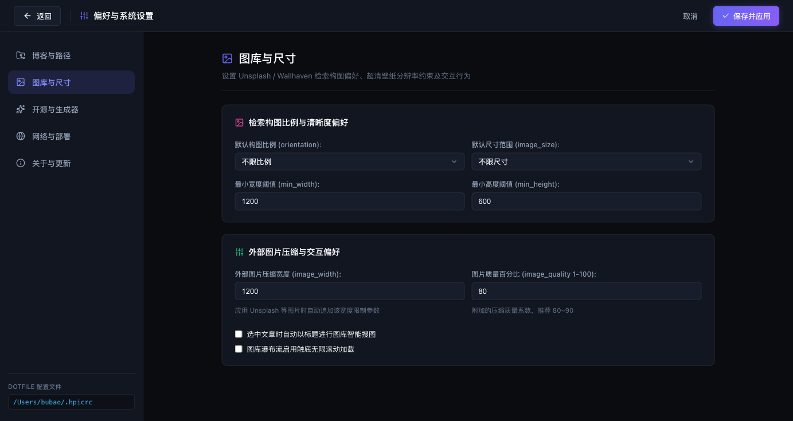

<h1 align="center">hpic</h1>

<p align="center">
  <strong>极简、免 Electron 的 Hexo 博客文章与草稿配图桌面管理工具</strong>
</p>

<p align="center">
  <a href="https://github.com/bubao/hpic/releases"></a>
  <a href="https://github.com/bubao/hpic/actions"></a>
  <a href="go.mod"></a>
  <a href="#安装与卸载"></a>
  <a href="安装与卸载"></a>
  <a href="安装与卸载"></a>
  <a href="LICENSE"></a>
  <a href="#"></a>
</p>


<p align="center">
  
</p>

**hpic** 是一个专为 Hexo 博客博主设计的轻量桌面配图管理工具。它通过读取和修改博文 Frontmatter 的元数据参数，帮助博主快速检索、挑选网络图片，并一键更新到指定的博文图片字段中，让博客配图变得轻松优雅。

后端基于 Go 编写，前端采用 React 19，静态资源直接内嵌到单一二进制文件中（约 12MB，压缩包约 5.5MB），无任何 Electron 运行时依赖，支持 macOS、Linux 与 Windows。

---

## 架构与运作流向



---

## 核心特性与界面一览

### 1. 深度递归扫描与双层正交筛选
- **同时支持正式文章与草稿**：配置 Hexo 博客根目录后，工具会自动递归遍历 `source/_posts`（已发布博文）与 `source/_drafts`（本地草稿）及其多级子目录。
- **双层正交交叉过滤**：文章范围（全部 / 正式文章 / 草稿）与配图状态（全部 / 待配图 / 已完成 / 404失效）自由交叉组合，支持按 Hexo 博客分类和多字段（标题、文件名、分类、标签）模糊检索。

### 2. 免 Key 图床检索与 4K 超清横屏适配
- **免 API Key 开箱即用**：内置 Unsplash 优质摄影与 Wallhaven 4K 超清壁纸源，无需注册或配置 Token。
- **构图与尺寸智能过滤**：支持按横屏（Landscape）、超宽（16:9 / 21:9）与高清（≥1200px）、2K/4K 自由筛选。
- **物理自然尺寸与规范化文件名透视**：即时探测真实渲染分辨率（如 `3840×2160`）、画面宽高比（`16:9`、`21:9` 等）以及规范化文件名推导。

<p align="center">
  
</p>

### 3. 极客代码卡片与技术栈横幅生成
- **GitHub Socialify**：一键生成现代化开源仓库卡片，实时定制主题样式。
- **SkillIcons**：技术栈横幅实时组合与预览，快速为技术文章添加说明横幅。

<p align="center">
  
</p>

### 4. 封面 404 健康体检与灵感收藏夹
- **并发健康检测**：零流量 `HTTP HEAD` 并发检测全站文章配图有效性，秒级定位超时或失效的外链。
- **灵感收藏夹与全局灯箱**：跨文章临时收藏心仪图片，支持全屏灯箱预览，规范化 Key 自动去重。

<p align="center">
  
</p>

### 5. 灵活偏好设置、自定义主题与安全 Git 部署
- **图库与尺寸偏好配置**：自由设定 Wallhaven / Unsplash 默认检索构图（横屏/竖屏/全部）、最小宽高阈值约束、图片质量压缩及无限滚动交互模式。
- **现代化主题与自由换肤**：原生支持暗色 (Dark)、亮色 (Light) 与跟随系统 (Auto) 顶栏一键切换；支持通过自定义 CSS 变量与 `custom.css` 打造专属调色板，内置精选皮肤预设，并可把整套配色保存为 `~/.config/hpic/themes/*.json` 自定义主题预设，在设置面板中一键切换与跨设备分享（详见 [换肤指南](docs/theme-guide.md)）。
- **全局命令面板**：按下 ⌘K / Ctrl+K 唤起命令面板，支持中文、英文与拼音首字母模糊检索，服务启停、主题切换、Hexo 生成部署与设置直达等操作全程纯键盘完成。
- **自定义 Frontmatter 字段与 Git 部署保护**：可任意指定博文封面键名（如 `index_img`、`banner_img`、`cover` 等）；部署前自动扫描工作区 `git status`，支持按需勾选本次要发布的文件，杜绝误推未完成的草稿。

<p align="center">
  
</p>

---

## 安装与卸载

### macOS

**方式一：DMG 安装包（推荐）**
- **Apple Silicon（M1 / M2 / M3 / M4）**：从 [Releases](https://github.com/bubao/hpic/releases) 下载 `hpic-v<版本号>-macOS-arm64.dmg`；
- **Intel 芯片（较老机型）**：从 [Releases](https://github.com/bubao/hpic/releases) 下载 `hpic-v<版本号>-macOS-amd64.dmg`；
- 双击打开 DMG，将 `hpic` 图标直接拖拽至 `Applications` 文件夹即可完成安装。

> 💡 macOS 安装包按架构拆分（arm64 / amd64），单份约 6MB，下载体积约为通用双架构版的一半；客户端【关于与更新】面板检测到新版本时，会自动按当前芯片匹配对应架构的安装包。

**方式二：源码编译安装（开发者）**
```bash
git clone https://github.com/bubao/hpic.git
cd hpic
./install.sh
```

**卸载方式：**
- 直接将 `hpic.app` 移入废纸篓；
- 或在终端执行 `hpic uninstall` / `./install.sh --uninstall` 自动清理软链与应用实体。

---

### Windows

**方式一：预编译安装向导 / 免安装包（推荐）**
- 从 [Releases](https://github.com/bubao/hpic/releases) 下载 `hpic-v<版本号>-setup-amd64.exe` 单文件安装向导直接双击安装；
- 或下载 `hpic-v<版本号>-windows-amd64.zip` 解压即用（仅含 `hpic.exe` 与 `install.ps1`、`uninstall.ps1` / `uninstall.cmd` 等集成脚本，内部副本不随包分发、体积更精简；运行 `install.ps1` 可一键创建桌面与开始菜单快捷方式并配置 PATH，并自动生成 `hpic-desktop.exe` 副本）。

**方式二：源码编译安装（开发者）**
```powershell
git clone https://github.com/bubao/hpic.git
cd hpic
.\install.ps1
```

- **规范化安装目录**：默认安装至用户程序目录 `%LOCALAPPDATA%\Programs\hpic`；
- **桌面与开始菜单**：自动创建带有专属快门图标的桌面快捷方式与开始菜单入口；
- **系统集成与卸载**：自动写入系统卸载信息，可在 Windows【已安装的应用】中一键卸载；
- **PATH 环境变量**：自动加入用户 PATH，在 CMD / PowerShell 中键入 `hpic` 即可运行。

**卸载方式：**
- **通过系统设置**：打开 Windows【设置 -> 应用 -> 已安装的应用】，找到 **hpic** 点击【卸载】；
- **通过开始菜单**：直接在开始菜单点击【卸载 hpic】；
- **通过命令行**：在终端运行 `hpic uninstall`。

---

### Linux

**方式一：Debian / Ubuntu 安装包（推荐）**
从 GitHub Releases 下载 `hpic_*.deb` 并直接安装：
```bash
sudo apt install ./hpic_*_amd64.deb
# 或 sudo dpkg -i hpic_*_amd64.deb
```

**方式二：预编译二进制压缩包**
从 Releases 下载 `hpic-v<版本号>-linux-amd64.tar.gz`，解压并将 `hpic` 移动至 `~/.local/bin/`：
```bash
tar -xzf hpic-linux-amd64.tar.gz
mkdir -p ~/.local/bin
mv hpic ~/.local/bin/
```

**方式三：源码编译安装（开发者）**
```bash
git clone https://github.com/bubao/hpic.git
cd hpic
./install.sh
```

**卸载方式：**
- deb 包卸载：`sudo apt remove hpic` 或 `sudo dpkg -r hpic`
- 命令行卸载：在终端直接运行 `hpic uninstall` 或在仓库目录执行 `./install.sh --uninstall`

---

## 常用命令

启动客户端与常用 CLI 工具：

```bash
# 启动（默认唤起窗口，若已在运行则置前现有窗口）
hpic

# 一键检查 GitHub 最新版本，按当前系统架构匹配热更新包并下载升级
hpic update

# 交互式完全卸载（彻底清理二进制与桌面集成）
hpic uninstall

# 查看当前安装版本
hpic version

# 查看软件版本更新历史记录 (CHANGELOG)
hpic changelog

# 显式指定 Hexo 博客根目录
hpic --hexo /path/to/blog

# 开启终端详细调试日志
hpic --debug

# 无头服务模式（仅启动后端 HTTP 服务，不自动唤起窗口）
hpic --headless
```

---

## 配置说明

hpic 启动时会自动读取并生成标准配置文件 `~/.config/hpic/config.json`（同时自动兼容历史遗留的 `~/.hpicrc`），也可以直接在客户端顶栏【偏好设置】中可视化修改。

简要配置示例：

```json
{
  "hexo_dir": "/Users/username/Blog",
  "cover_fields": [
    "index_img",
    "banner_img"
  ],
  "deploy_mode": "git",
  "proxy": "",
  "orientation": "landscape",
  "image_size": "large"
}
```

各字段详细说明请参阅 [配置文档](docs/config.md)，自定义样式与换肤请参阅 [自定义换肤与主题指南](docs/theme-guide.md)。

---

## 开发者与贡献

如果您是开发者或想要在本地调试、从源码构建并参与贡献，请参阅：
- [开发与贡献指南 (docs/development.md)](docs/development.md)（含本地环境配置、前后端联调、增量构建、单元测试 TDD 与全平台跨平台发布向导）。

---

## 更多文档

- [系统架构与设计原理](docs/architecture.md)
- [配置完整指南](docs/config.md)
- [自定义换肤与主题样式指南](docs/theme-guide.md)
- [本地开发与贡献指南](docs/development.md)
- [常见问题排查 (FAQ)](docs/faq.md)

---

## 开源许可

[MIT License](LICENSE)
