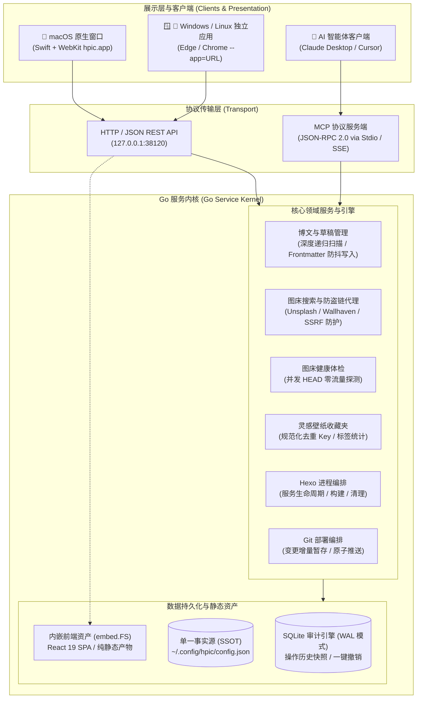
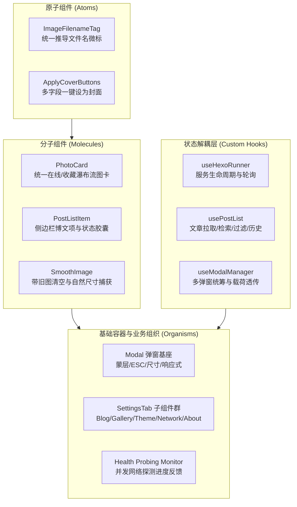

# 系统架构与实现原理

hpic 是一个免 Electron 的轻量级 Hexo 博客配图桌面管理工具。本文档简要介绍其核心架构与设计实现。

---

## 1. 架构总览

系统采用 **Go 内核 + React 19 前端单页** 架构。前端静态资源通过 Go 1.16+ 的 `//go:embed` 直接内嵌至最终二进制中，整体可执行文件约 12MB（压缩包约 5.5MB），无任何 Electron 运行时依赖。

---

## 2. 核心机制

### 2.1 目录自动推导与深度递归文章扫描
- **以博客根目录为基准**：用户只需配置 `hexo_dir`。程序自动探测其包含的 `_config.yml`。
- **文章与草稿深度递归索引**：通过 `filepath.WalkDir` 自动递归遍历 `source/_posts` 与 `source/_drafts` 及其所有任意深度的多级分类子目录（例如 `source/_posts/tech/go/`），同时自动跳过隐藏文件夹（如 `.git`, `.trash`），并在前端通过文章范围维度和配图状态维度实现正交组合过滤。

### 2.2 Markdown Frontmatter 幂等解析
- **格式保护**：解析 Frontmatter 时严格保留原有缩进与 Markdown 正文，杜绝破坏性重排。
- **字母序键名稳定**：修改或新增图片字段时，未变更键名保留原位，新键名按字母序插入，防止 Go `map` 随机遍历引发 Git Diff 抖动。
- **BOM 头自愈**：自动检测并剥除 Windows 常见 UTF-8 BOM（`\xef\xbb\xbf`）。

### 2.3 免 Electron 原生独立窗口
- **macOS**：通过 `native_macos/main.swift` 构建约 120KB 的轻量原生启动器，调用系统 WebKit 并绑定独立 Dock 图标与系统菜单。
- **Windows / Linux**：检测系统中已安装的现代浏览器（Edge / Chrome / Chromium），通过 `--app=http://127.0.0.1:port` 唤起无地址栏、无书签栏的独立应用窗口。

### 2.4 本地防盗链图片代理与 SSRF 安全防御 (`/api/image/proxy`)
部分外部图床存在防盗链 Referer 限制。当 WebKit / 浏览器直接加载图片失败时，前端自动降级走本地代理：
- **安全过滤与 SSRF 防护**：对目标 URL 解析后的主机名及 IP 地址进行严格校验，阻断本地回环地址（`127.0.0.0/8`, `::1`）、局域网私有网段（`10.0.0.0/8`, `172.16.0.0/12`, `192.168.0.0/16`）、链路本地与保留网段，仅允许向公网合法 HTTP/HTTPS 目标发起代理；
- **身份认证与特殊字符容错**：支持带认证凭据的 HTTP/SOCKS5 代理（如 `http://user:p@ss:word@127.0.0.1:7890`），底层通过 `httputil.ParseProxyURL` 安全处理特殊符号，同时支持 HTTP 407 认证响应解析；
- **代理连通性即时测试**：提供 `/api/config/proxy-test` 接口，支持在设置界面一键校验代理服务器连通性。

### 2.5 规范化图片标识 (`NormalizeImageKey`)
针对同一张图片在不同裁剪参数（`?w=...&q=...`）下 URL 不一致的问题，提取规范化图片 ID（如 `unsplash::photo-xxx` 或 Wallhaven ID），实现收藏夹全局去重以及精准标记“当前博文使用中”。

### 2.6 安全可控的 Git 部署
部署前先扫描当前仓库的 `git status -s`，并在界面中列出待提交文件供博主勾选，仅对选中文件执行暂存和提交，避免误推敏感文件或未完成的草稿。

### 2.7 严密防残影的图片平滑过渡状态机 (Clear-on-Change)
在 DOM 组件复用（如连续切换封面、翻页浏览缩略图、查看大图灯箱）时，为杜绝网络延时造成的“上一张旧图一直残留在屏幕上”的视觉割裂，系统引入了严格的图片加载状态机：
1. **变更即清空 (第 0 帧)**：当传入的目标图片 URL 发生变化时，立即重置并卸载旧图 DOM；
2. **骨架微光流光 (Skeleton Transition)**：进入占位微光过渡状态，给予用户明确的缓冲预期；
3. **就绪微缩放淡入 (Smooth Bloom)**：通过后台原生 `Image.onload` 确认完全载入后，挂载全新 DOM 节点并触发微缩放与模糊淡入动效。

### 2.8 全场景图片物理尺寸与文件名解析 (Natural Dimension Discovery)
为了保证所有类型的图片资源（Unsplash 摄影、Wallhaven 4K、本地文件、矢量海报 DataURI、Socialify 仓库卡片以及 SkillIcons 横幅）渲染体验的一致性，系统建立了双层元数据解析架构：
1. **网络级微数据解析 (Scraper Regex)**：针对外部图床页面，在抓取阶段使用正则精确解析原始宽度与高度；
2. **浏览器物理自然尺寸捕获 (Client-side Discovery)**：对于无服务端元数据的资源（如实时生成的 SVG、网络图片等），在 DOM 挂载时通过浏览器的 `HTMLImageElement.naturalWidth` 和 `naturalHeight` 即时检测物理像素，并通过 `getImageAspectRatio` 自动匹配标准比例（16:9, 21:9, 4:3, 1:1, 9:16 等）；
3. **通用文件名规范化 (`imageMeta.ts`)**：统一对各类复杂带参链接推导简明直观的文件名与扩展名，在卡片、封面区与全屏灯箱中完整透视呈现。

### 2.9 轻量化健康体检引擎 (Zero-Body-Cost HEAD & Range Fallback)
为杜绝体检全量扫描数十上百篇博文时耗尽网络带宽，体检探测设计了双级轻量化过滤模型：
1. **优先 `HTTP HEAD` 协议**：仅获取 HTTP 响应头和状态码（200/404 等），**图片内容下载量严格为 0 字节**，连接毫秒级断开与复用；
2. **严格防盗链 CDN 降级防御 (`Range: bytes=0-1024`)**：若目标图床服务器禁用了 HEAD 请求（返回 405 Method Not Allowed 或 403 Forbidden），探测器平滑降级为带有 `Range: bytes=0-1024` 的轻量 GET 请求，只嗅探前 1KB 的元数据切片，接收到状态后立即调用 `Close()` 熔断连接，彻底防止下载整张巨幅高清大图。

### 2.10 自升级引擎与热替换安全机制 (Atomic In-Place Self-Updating)
系统内置自动化更新检测与就地升级热替换引擎（In-App Updater）：
1. **版本检测与静默轮询**：前端每 10 分钟在后台静默轮询一次 GitHub Releases API，顶栏提供永久更新状态徽标；
2. **下载前安全断言与 Payload 隔离**：在自升级触发下载前，严格校验目标产物后缀，杜绝将面向用户的安装镜像（如 `.dmg`）误作为原地可执行热替换目标，必须匹配当前操作系统架构的压缩归档（`darwin-<arch>.tar.gz` / `windows-<arch>.zip` / `linux-<arch>.tar.gz`）；手动安装包的挑选同样优先按当前芯片匹配同架构镜像（macOS `-arm64` / `-amd64.dmg`），并在无匹配时明确提示前往 Release 页面手动下载；
3. **原子文件替换 (`atomicReplaceFile`)**：针对 Windows / Linux / macOS 下“正在运行的进程二进制文件被 OS 独占锁定不可直接覆写”的特性，采用两步法（下载 ➔ 重命名旧文件为 `.old` 临时文件 ➔ 移动替换新文件 ➔ 调度清理），实现无缝热替换；Windows 平台运行中的 `.exe` 会阻断直接覆盖，此时新版二进制先持久写入同目录 sidecar 文件 `.hpic_update_pending`，待应用退出后由重启辅助脚本消费并完成最终写回；
4. **macOS 自动重签名**：在 macOS 替换二进制后，自动调用系统 `codesign --force --options runtime --sign -` 重新签署，防止 macOS Gatekeeper 触发代码完整性拦截。

### 2.11 失效配图闭环追踪与全局状态同步 (Persistent Broken Asset Lifecycle)
为防止用户在全屏预览大图（Lightbox）或卡片浏览中发现图片 404 失效，一旦关闭灯箱后状态遗失、无法在博文封面区对齐修复的问题，系统建立了全局失效追踪与状态同步机制：
1. **即时体检与事件捕获**：在灯箱打开加载及封面渲染时，一旦遇到网络加载异常或 `/api/post/check-health` 探测返回 `is_broken`，立即触发 `onMarkBroken` 回调；
2. **顶层状态提升 (`App.tsx`)**：将失效 URL 统一收拢至顶层 `brokenUrls` 集合与 `brokenReports` 报告列表，并依据图片 URL 自动反查其归属的博文路径与对应配置字段；
3. **全局多端即时联动**：
   - **封面编辑区 (`CoverArea`)**：关联字段即刻应用高亮红框警示，右上角挂载 `404 失效` 红色警告徽标，并在顶部常驻醒目的整篇失效横幅，引导博主一键更换；
   - **文章列表 (`Sidebar`)**：对应博文项的健康指示即刻变更为醒目的红色 `配图失效` 徽标；
   - **图库与收藏夹 (`PhotoGallery` / `PhotoCard`)**：搜索列表或收藏夹中的失效卡片立即降低饱和度并显示 `404 失效` 角标，防止再次误选失效图片。

### 2.12 Go API 领域 Handler 垂直拆解 (Decoupled Domain Handlers)
为杜绝后端巨石化（Monolith），服务层采用同 package `api` 下挂载在 `(s *Server)` 接收器上的多领域 Handler 拆解架构：
- **`server.go` (~400 行)**：负责生命周期构造与资源清理 (`NewServer` / `Close`)、集中路由注册 (`routes()`) 以及网络安全基座（SSRF 探测、路径遍历校验与本地 Origin 鉴权）；
- **`handler_posts.go`**：文章列表扫描、单篇博文读取、Frontmatter 增改删、正文插入配图与操作审计（底层委托 `service` 层编排）；
- **`handler_hexo.go`**：Hexo 服务进程启停调度、状态轮询、静态生成与 Git 部署集成；
- **`handler_proxy.go`**：海外图床安全防盗链代理转发与连通性检测；
- **`handler_search.go`**：Unsplash 检索、GitHub 动态卡片 (Socialify / SkillIcons) 预览与收藏夹管理；
- **`handler_gallery.go`**：统一图库适配层 (`internal/gallery`) 的 Provider 列表与检索编排；
- **`handler_theme.go`**：外观预设清单下发与主题目录定位；
- **`handler_i18n.go` / `handler_doctor.go`**：本地语言包管理与运行时只读诊断、诊断包导出；
- **`handler_config.go`**：用户配置读写、旧版配置迁移、原生目录选择对话框与自升级链路。

### 2.13 SQLite 事务审计与单一事实源 (SSOT & Connection Pool Governance)
系统明确划清静态配置与机器运行时动态数据的单向权责边界：
1. **单一事实源 (SSOT)**：用户偏好配置（HexoDir、代理、Cover 字段等）以纯 JSON 文本（`~/.config/hpic/config.json` 或 `~/.hpicrc`）为唯一事实源，严格禁止向数据库反向双写；
2. **纯 Go 免 CGO SQLite 引擎 (`modernc.org/sqlite`)**：持久化管理博文变更审计日志 (`operation_logs`)、收藏夹 (`favorites`) 与搜索历史；
3. **连接池治理与锁竞争免疫**：开启 `WAL` (Write-Ahead Logging) 模式与 `busy_timeout(5000)`，并通过显式限制连接池（`SetMaxOpenConns(1)` / `SetMaxIdleConns(1)`），在纯 Go 运行时下彻底消除高频读写时的文件锁锁死风险。

### 2.14 外观预设系统 (Theme Presets)
系统将皮肤抽象为可移植的预设对象（`Preset`: id/name/desc/theme/css），内置预设随程序嵌入；用户可在标准目录 `~/.config/hpic/themes/*.json` 放置自定义预设，同名 `id` 可覆盖内置预设的对应字段。`/api/theme/presets` 统一汇总下发（含 `themes_dir`），外观设置面板支持扫描刷新、一键应用与目录定位。

### 2.15 Model Context Protocol (MCP) 架构与统一领域层抽象
为了使现代 AI 客户端（如 Claude Desktop、Cursor 等）能够直接以结构化工具形式协同管理博客与图床，系统深度集成了符合 JSON-RPC 2.0 规范的 MCP 服务端：
1. **统一领域服务 (`service.PostsService`)**：REST API 与 MCP Tool 共用同一套核心领域服务，确保在通过 AI 助手执行换封面、新增草稿或回滚时，严格复用 YAML Frontmatter 幂等解析、事务快照与并发防抖机制；
2. **依赖注入与工具注册工厂 (`internal/mcp/registry.go`)**：通过 `RegisterTool` 模式将业务依赖（`Config`、`Runner`、`Database`、`PostsTracker`）注入到每个独立 Tool 实例中，实现关注点分离与清晰的单元测试隔离；
3. **双传输通道**：支持 `hpic mcp` 基于标准输入输出（stdio）直接对接本地桌面 AI 客户端，亦支持挂载在 Web 服务的 `/api/mcp` 端点上。

---

## 3. 跨平台打包与分发管道

| 平台 | 打包流程与产物 | 交付形态与系统集成 |
| :--- | :--- | :--- |
| **🍎 macOS** | `make dmg` / `scripts/package-macos-arch-dmgs.sh` 按架构拆分生成 `dist/hpic-v${VERSION}-macOS-{arm64,amd64}.dmg` | 原生 WebKit 独立窗口 App Bundle，单架构约 6MB，提供 Applications 拖拽安装与优雅卸载 |
| **🪟 Windows** | 交叉编译为 `dist/hpic-windows-amd64.zip`（仅含 `hpic.exe`）与 `dist/hpic-setup-amd64.exe` (NSIS) | 部署至 `%LOCALAPPDATA%\Programs\hpic`，配置专属图标快捷方式、开始菜单（含主程序与卸载入口）、自动配置 PATH，并注册至控制面板「已安装的应用」与 `uninstall.cmd` |
| **🐧 Linux** | 编译 `dist/hpic-linux-amd64.tar.gz` 与 `dist/hpic_*.deb` | 标准 XDG 桌面菜单集成（`hpic.desktop` + `icon.png`）；Debian/Ubuntu 提供标准 `.deb` 安装包支持（基于 POSIX `ar + tar` 原生组装，跨平台免 root 生成） |
| **全平台汇总** | `make dist` / `scripts/build-all.sh` / `scripts/build-all.ps1` | 一键十余秒内跨平台编译并输出全部 3 大系统所有架构的压缩包、安装向导及 SHA256 校验清单 |

---

## 4. 前端组件化架构与设计模式 (Frontend Atomic & Molecular Architecture)

前端基于 React 19 + TypeScript + Vite 体系构建，杜绝面向过程的代码堆砌，全面采用组件化与领域 Hooks 开发设计：

1. **原子化元数据呈现 (`ImageFilenameTag`)**：对任意 URL 执行智能推导，统一展示图标、等宽文件名、物理分辨率徽标与完整 URL Tooltip；
2. **封面应用动作抽象 (`ApplyCoverButtons`)**：封装「设为全部」与动态 frontmatter 字段（如 `index_img`, `banner_img`），支持尺寸与变体切换；
3. **弹窗基底标准化 (`Modal`)**：彻底收敛 Backdrop 蒙层、居中布局、动态尺寸预设（sm/md/lg/xl）、全局 Escape 键盘监听以及防穿透事件处理；
4. **生成器模块解耦 (`generators/`)**：将庞大的 `Generators` 分解为独立的 `PosterGenerator`、`SocialifyGenerator` 和 `SkillIconsGenerator`，保持清晰的单向数据流与专注的业务职责；
5. **顶层状态解耦与 Custom Hooks 模式 (`hooks/`)**：`App.tsx` 作为轻量协调器（Coordinator），将文章过滤/检索逻辑封装进 `usePostList`，Hexo 服务监控与部署联动封装进 `useHexoRunner`，全站弹窗状态与载荷封装进 `useModalManager`，外观控制、博文变更与失效图片全局登记分别封装进 `useAppearanceController` / `usePostMutator` / `useBrokenImageRegistry`；
6. **设置弹窗多 Tab 组件化 (`components/settings/`)**：设置面板解耦为受控子组件（`BlogTab`、`AppearanceTab`、`I18nTab`、`GalleryTab`、`GeneratorsTab`、`NetworkTab`、`DoctorTab`、`AboutTab`），按需懒加载，主弹窗仅负责骨架导航与保存分发。
7. **全局命令面板 (Command Palette)**：`Ctrl/⌘ + K` 唤起，`src/commands/` 注册表汇总服务控制、文章跳转、主题切换、Hexo 操作与设置直达等命令，由自研 `commandMatcher` 做模糊匹配（支持中文、英文与拼音首字母关键词），实现全程键盘的高效操作流。

