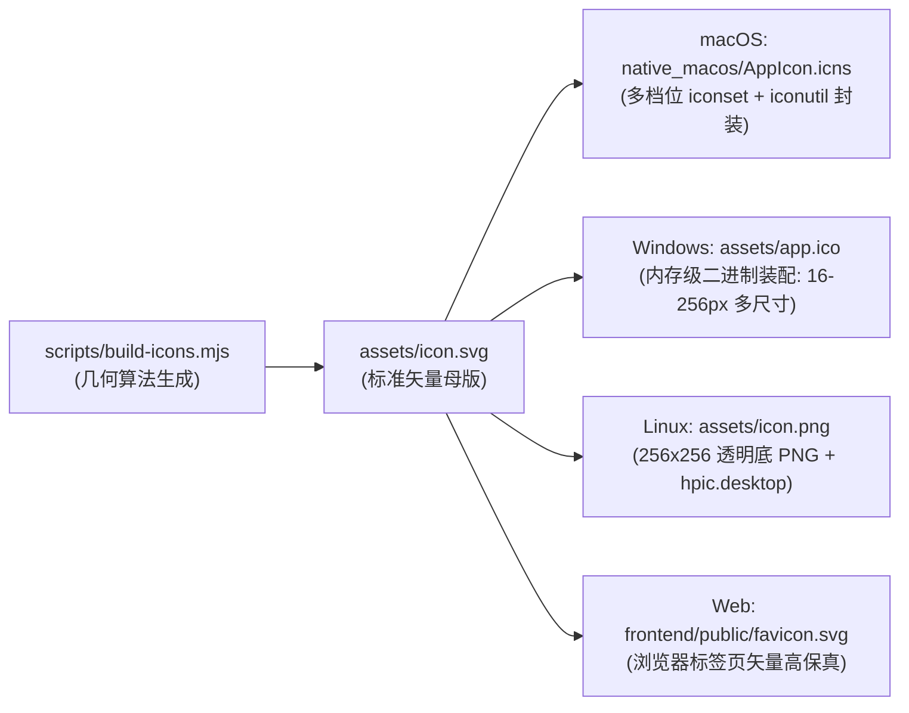

# 图标设计与声明式构建指南 (Icon Architecture)

hpic 拥有高辨识度的六色快门图标，象征着博客文章封面配图与视觉快门的结合。本文档详细记录图标的**数学几何系统、莫比乌斯环形互锁拓扑、色彩光学规范以及跨平台全自动编译派生管线**。

---

## 1. 架构范式：声明式代码即图形 (Code as Truth)

与传统软件使用 Figma 或 Illustrator 手工导出静态图片不同，hpic 采用 **“声明式代码即设计真相（Declarative Code-as-Graphic）”** 架构：

- **最高权威事实源（SSOT）**：位于 [`scripts/build-icons.mjs`](../scripts/build-icons.mjs) 中的几何参数配置与 `generateIconSvg()` 算法；
- **免人工失误**：所有的角度、切线、圆弧与阴影均由解析几何公式计算生成，根治了矢量软件手动绘制时容易产生的像素偏离与不对称；
- **自动化构建**：运行 `node scripts/build-icons.mjs` 即可自动衍生出全套多平台图标资产，并全自动同步至 macOS、Windows、Linux 与 Web。

---

## 2. 几何拓扑与光学物理系统

```
             ┌────────────────────────────────────────────────────────┐
             │       Elevation Shadow Stack (3 阶物理漫反射底托投影)    │
             │       dy: 26 (α=0.06) ➔ dy: 18 (α=0.10) ➔ dy: 10 (α=0.15) │
             └───────────────────────────┬────────────────────────────┘
                                         │
                                         ▼
             ┌────────────────────────────────────────────────────────┐
             │        Squircle Card (880x880 纯白大圆角卡片底板)         │
             └───────────────────────────┬────────────────────────────┘
                                         │
                                         ▼
             ┌────────────────────────────────────────────────────────┐
             │        C6 对称群六色莫比乌斯环形互锁架构 (Mobius Shutter) │
             │                                                        │
             │   1. Base (基底扇区)   : 6 块 60° 扇区铺满 360° 环        │
             │   2. Flap (顶层搭接)   : 旋转向外顺延压覆下一瓣            │
             │   3. Shadow (接触羽化) : 沿接缝投射纯线性渐变微阴影        │
             └────────────────────────────────────────────────────────┘
```

### 2.1 莫比乌斯环形互锁 (Mobius Interlocking Tri-Layer)
六片快门叶片呈圆环状首尾相接，传统的单层矢量绘制必然会遇到“哪一片在最底层、哪一片在最顶层”的 **Z-Index 拓扑死锁问题**（导致最后一片无法压住第一片）。

hpic 采用创新的**三层解耦互锁算法**：
1. **基底扇区 (`Base`)**：
   - 形状为严格的 $60^\circ$ 扇形大圆弧（内径切入六边形孔径，外径 $R=430$）；
   - 6 片依次旋转 $0^\circ, 60^\circ, 120^\circ, 180^\circ, 240^\circ, 300^\circ$，刚好完全密铺为一个无缝闭环。
2. **顶层搭接片 (`Flap`)**：
   - 每个叶片带有小角度向外延伸并向内融入同色基底的搭接片（Flap）；
   - 将 6 片 Flap 全部渲染在所有 Base 之上，顺时针各压在下一叶片的主体上，形成在平面上呈现如同莫比乌斯环般的“每一片都压着前一片、又被后一片压着”的完美连续视觉。
3. **环形切线接触阴影 (`Shadow`)**：
   - 在交界线上覆盖带有线性透明度梯度的阴影矩形（宽度 24px，起始透明度 0.22 逐步平滑渐变到 0）；
   - 6 道阴影完全等长、等宽、绝对均匀对称，彻底消除了手工绘图时阴影交错重叠、浓淡不均的杂质感。

### 2.2 六角孔径几何数学 (Hexagonal Aperture)
- 快门中心自然收束为对称的**正六边形镜头孔径**；
- 几何参数：内切圆半径 $R_{in} = 110\text{ px}$，边长 $a = \frac{2 \times 110}{\sqrt{3}} \approx 127\text{ px}$；
- 外围环绕 $R=436\text{ px}$ 的超轻快门运动轨迹导轨轨道环。

### 2.3 高饱和全色调色板 (6-Blade Palette)
顺时针 $60^\circ$ 均匀分布的高对比度色谱：

| 角度方位 | 色彩名称 | 十六进制色值 | 视觉象征 |
| :--- | :--- | :--- | :--- |
| **$0^\circ$ (顶偏右)** | 阳光朱红 (Red) | `#ef4444` | 热情与活力 |
| **$60^\circ$ (右下偏上)** | 活力珊瑚 (Orange) | `#f97316` | 创作与灵感 |
| **$120^\circ$ (右下偏下)** | 明亮金黄 (Yellow) | `#eab308` | 晨曦与快门微光 |
| **$180^\circ$ (底部)** | 翡翠纯绿 (Green) | `#10b981` | 稳定与健康检查 |
| **$240^\circ$ (左下)** | 科技湛蓝 (Blue) | `#3b82f6` | 极客与技术博客 |
| **$300^\circ$ (左上)** | 典雅紫罗兰 (Purple) | `#8b5cf6` | 优雅排版与格调 |

---

## 3. 跨平台编译与资产派生交付管线

运行 `node scripts/build-icons.mjs`，构建脚本会自动完成全平台原生图标文件的生成与无缝部署：



| 交付平台 | 目标文件路径 | 规格与技术细节 |
| :--- | :--- | :--- |
| **🍎 macOS** | `native_macos/AppIcon.icns` | 生成 16x16 至 512x512@2x 完整 10 档分辨率的 `.iconset`，调用系统原生 `iconutil` 封装为苹果专属 `.icns` 格式，嵌入独立 WebKit 窗口菜单与 Dock。 |
| **🪟 Windows** | `assets/app.ico` | **无需任何第三方外部命令行依赖**。通过 Node.js 原生 `Buffer` 内存拼接微软标准 ICO 二进制协议头，内嵌 16/32/48/64/128/256px 六档位无损图标簇，用于 Windows 可执行文件、任务栏、桌面快捷方式和控制面板卸载项。 |
| **🐧 Linux** | `assets/icon.png` | 256x256 高清透明背景 PNG，与自动生成的 `assets/hpic.desktop` 共同放置于系统 `/usr/share/pixmaps`，被 GNOME / KDE / XFCE 自动收录。 |
| **🌐 Web 端** | `frontend/public/favicon.svg` | 前端公共资源 Favicon，暗色与浅色浏览器标签页自适应高保真矢量呈现。 |

---

## 4. SVG 转 PNG 渲染引擎三级智能降级策略

为了在不同开发环境（开发者个人电脑、精简容器、云端 GitHub Actions Runners）中都能零故障输出高保真位图，脚本内置了**三级渲染后端自动降级引擎**：

1. **第一优先级：`rsvg-convert`**
   - 性能最高、矢量渐变支持最好的轻量引擎（macOS: `brew install librsvg`；Ubuntu: `sudo apt install librsvg2-bin`）。
2. **第二优先级：`inkscape`**
   - 工业级开源矢量处理工具备选（若系统中已安装 Inkscape 则自动调用）。
3. **第三优先级：macOS 原生 `qlmanage` (系统内置，零依赖保底)**
   - 如果宿主机为 macOS 且上述工具均未安装，脚本将自动调用系统原生 QuickLook 引擎（`qlmanage -t -s <size>`）自动转译，**实现 macOS 下完全开箱即用、无需安装任何第三方工具即可产出原汁原味的 ICNS 图标簇**。

---

## 5. 本地开发与重新生成指令

当需要调整图标颜色、外形或阴影时，只需编辑 [`scripts/build-icons.mjs`](../scripts/build-icons.mjs) 中的 `ICON_THEME` 参数，然后运行：

```bash
node scripts/build-icons.mjs
```

终端将打印派生进度：
```text
🎨 正在编译派生全套跨平台多分辨率应用图标...
   ✓ 写入 assets/icon.svg (声明式设计母版)
   ✓ 写入 frontend/public/favicon.svg (Web Favicon)
   ✓ 渲染 256x256 PNG: assets/icon.png
   ✓ 纯内存构建生成 Windows 多尺寸 ICO: assets/app.ico (内嵌 16/32/48/64/128/256px)
   ✓ 成功封装 macOS AppIcon.icns (已适配至 native_macos/)
   ✓ 自动生成 Linux XDG 规范配置: assets/hpic.desktop
🎉 全套跨平台图标与配置文件已全部编译就绪！
```
所有衍生资源将即刻更新，无缝参与 `make`、`make dist` 与发布流水线。
